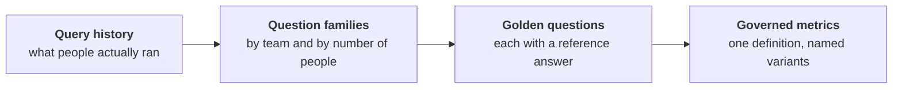
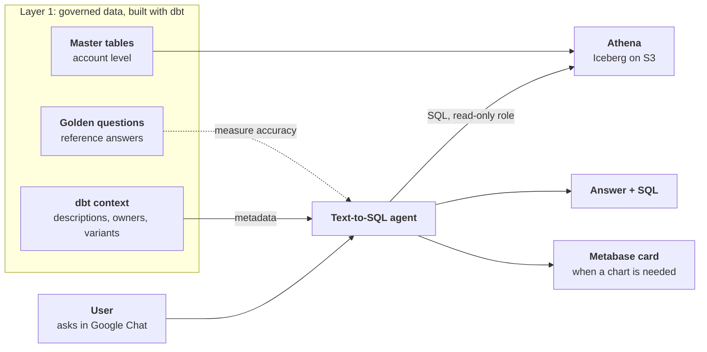

When I joined my current company I was the person who knew Spark, which was more or less the whole pitch, because I knew AWS and how to move data from one place to another but I knew almost nothing about how a company that sells WhatsApp and voice automations actually makes money.

I'll be honest about that, because the rest of this series only makes sense if you know where I started: **I was not a data person with a business brain, I was a pipeline person who had to grow one.**

Skip ahead a few months to a meeting I still remember, where two people looked at the same question, "how many accounts churned last month?", and came back with **two different numbers that were both right**. I was the one who had built both tables and I felt ashamed, because I had no idea which one to defend.

Let me go back to how we got there, and I'll split it into three parts: the problem, the research I did about it and the solution I proposed.

## Everyone is building an agent

You've probably noticed the fever. Every company wants an AI agent and every demo shows one answering questions about data in a few seconds, and I wanted that too, because **an agent can be genuinely useful when you give it good context about your own data**, to the point of becoming a tool that answers questions in your place.

The problem is that I got overwhelmed. Every article I opened talked about RAG, embeddings, vector databases and LangChain, and I was convinced I had to learn all of it before I could build anything, so for a few weeks I felt like I was already late. It took me a while to see that **my strength was somewhere else: knowing how to get the data into shape** so that anything downstream can trust it.

That matters more than any of those tools, because an agent is only as good as what it reads. If your tables hold two definitions of the same word the agent will pick one without telling you and sound completely sure about it, and if your column names mean nothing it will guess. A model doesn't fix messy data, it makes the mess faster and more convincing, so **garbage in, garbage out**, only now the garbage comes with good grammar.

I didn't understand that when I started, and I learned it from the data.

## The lakehouse nobody knew they needed: the start of a problem

The first thing I built was the lakehouse, with S3, Iceberg tables, Athena on top and Metabase for the dashboards, and at the beginning **it was only meant to manage analytical tables for Finance** so they could see them in Metabase. The other departments hadn't asked for it because they didn't know they needed it, which is a different thing from not wanting it.

Then other teams saw what Finance was doing and realized it was super useful for monitoring how customers use the product and how they behave, and also for spotting patterns in that behavior that nobody had been able to see before. Marketing and Operations started asking for access, and soon they were making decisions with data that used to take them days to chase.

All of this rested on me, because **I was the only person maintaining the data infrastructure** on AWS and Metabase, with Glue, Lambda, CloudWatch, Kinesis and EC2, while I also built new ETL pipelines and handled requests from managers in other departments at the same time.

That was the good part and I'm still proud of it, but **handling ad-hoc requests to add information or create new tables was repetitive and wore me out**, because every answer opened the door to the next request.

## The problem: Identifying Data Organization Needs Across the Business

### I never asked what they needed

Managers started asking me for aggregated data built on top of the first tables I had created, so there was a dashboard here, a table there, the same dashboard again with one filter changed and a custom query for a presentation on Friday.

I delivered what was asked every single time, and that was my mistake, because **I never stopped to ask what each department actually needed the data for**. When someone asked for a table I built the table, without knowing that this person would need three more columns next month or that what they really wanted was something easy to join with another domain, so they could compare usage against the revenue a customer generates or follow churn, upsells and downgrades.

The strange thing is that **they didn't know what they really wanted either** until I handed them something. They would look at the first version and say "OK, I'd also like to see the number of messages sent by the AI, or answered by the AI", or "fine, apart from the `account_id` and the name, add the country, the subscription type, whether it has a partner and the plan it uses". I would never have thought they needed those columns and neither had they, until they saw a table without them.

I was embarrassed when I finally saw it, because I had been just a fast order-taker.

### Unoptimized queries were burning money

Everything ran in Athena against Iceberg tables in S3, so **what really mattered was the gigabytes scanned**, since that is what each query costs.

Managers and analysts had started building their own queries and dashboards in Metabase, with the best intentions, but they crossed many tables and none of it was materialized, so all of it ran again from scratch every time someone hit refresh, which meant the same heavy work over and over to get a number that barely changed from one hour to the next. A **materialized table** that computes it once would have scanned a fraction of those gigabytes.

That also raised a modeling question I couldn't answer yet, which was how to design tables that stay adjustable, because business rules change and if every change means rebuilding history you never keep up and you're never sure the new number matches the old one.

### Same word but different metrics

This is what the meeting was really about, because the real problem was never the requests but the fact that **no department shared a definition**.

One manager counted an account as churned when its payments stopped and another counted it when the account stopped showing signs of life, and both could defend their answer, so churn ended up with **four definitions** living in the lakehouse at the same time.

Net revenue retention was the same story and moved **around ten points** depending on which table you read, and MRR had two honest answers that differed by **about a third** because one counted prepaid credit and the other didn't. Each manager was correct inside their own question, but they weren't asking the same one.

I already knew Ralph Kimball's *The Data Warehouse Toolkit*, because I had used it as a reference to decide which tables were transactional, periodic or snapshot and to organize the information into dimensions. What I hadn't felt until then were **conformed dimensions** from the other side, as the thing that was missing when every department defined the same word its own way.

### Wearing a hat

When a number didn't add up people came to me to ask how a metric was calculated or what the definition of churn was, **as if I were the head of Finance or the head of Operations**, and I had to wear a different hat every time.

I wasn't any of them but the engineer who had built the table, so I could tell you what the SQL did and not whether that was what the business meant, and I felt stuck in the middle, because each answer I gave was really a decision about someone else's definition that nobody had asked me to make.

## The research: Analyzing how colleagues understand and query data

### Looking for a way out

I started to think about what kept repeating, which was constant requests for slightly different data, questions about what a metric meant and numbers that didn't match between two dashboards.

At some point it occurred to me that most of these were just questions and that an agent could answer them in my place, but I had just learned that an agent on top of this data would repeat every contradiction at full speed, so before building anything I had to understand what people really asked.

### Reading what people actually ran

This was going to be a side project, and everybody in the company knew that the way we worked was not sustainable and that we needed a solution, but nobody had a clear idea of where to start. The idea came when I realized that **instead of remembering requests or going around asking every manager what they needed, I could look at what I had already built for them**: the latest tables and queries I had delivered, which let me reconstruct what each team needed. And then I could go one step further and check **which ones were used the most**, which told me what each team really cared about.

That is why I opened Metabase and Athena, since Metabase sends every query to Athena and that let me see what each team ran, how often and how many different people ran the same thing, which was much faster than any conversation. I grouped the queries into families and looked at the newest ones, the most executed and the ones shared by the most people, and I also went through the dashboards created recently and listed the requests that reached me most often.

What came out was clearer than any meeting:

- A handful of question families were rewritten, each a little differently, by many different people.
- Most of the query volume came from a single automated process and not from a person.
- A lot of people checked whether a table was fresh before trusting it, which is a question in itself.
- One person checked the same account every single day.
- Some prices and rates were written by hand inside queries, so nobody owned them and they were **definitions without an owner**.

Reading the demand first gave me something that asking managers never did, which was a list of questions that real people ask, in their own words.

## The proposal: A two-layer architecture

Everything I had found pointed in the same direction: **an agent could take work off my plate** and, at the same time, **give people faster access to the data** they needed, without waiting for me to build the next table. But to make a good agent I needed **a solid structure that organized the tables and the data properly, and metrics that were well defined**, because otherwise the agent would only answer the wrong question faster.

The proposal consists of two sequential layers:

### Layer 1: Governed Data Infrastructure
1. Define each business metric **once**, assigning explicit ownership and named variants (e.g., `mrr_prepaid_included`).
2. Build standardized account-level master tables for easy cross-domain joins.
3. Transform top query-log patterns into a set of **"golden questions"** with validated benchmark outputs to evaluate the agent's accuracy.

All of that would live in **dbt**, which runs on top of Athena through the dbt-athena adapter and transforms the data already sitting in S3 as Iceberg tables, so it fits into the lakehouse I already had without adding a new platform.

### Layer 2: The Text-to-SQL Agent Workflow
1. A user asks a question in **Google Chat** (our primary team communication tool).
2. The agent reads dbt-generated metadata/context (metric definitions, descriptions, variant names).
3. It constructs SQL and executes it against Athena using a read-only role with restricted access to PII.
4. It returns the answer alongside the generated SQL—or creates a Metabase card if a visualization is needed.

I pitched this to my manager to secure dedicated engineering time. To make the business case, I mapped out how **dbt** would power the governance layer:

- **Descriptions & Metadata:** Serve as the semantic glossary consumed by the LLM.
- **Contracts & Testing:** Prevent schema/definition drift from breaking downstream models.
- **Reconciliation Tests:** Automatically compare source and target numbers.
- **Macros:** Encapsulate complex, changing business logic.
- **dbt Docs:** Function as the primary knowledge base feeding the agent's context window.

*One open challenge remains:* The company is transitioning from a traditional subscription model to a credit-based system. Deciding whether unspent credits count toward MRR isn't an engineering decision—yet it dictates the number half the company relies on.

## What's Next?

In **Part 2**, I'll dive deep into building the **Semantic Layer**: how I modeled metrics with dbt, structured master tables into an LLM-friendly context, and prepared our data stack for the agent.
